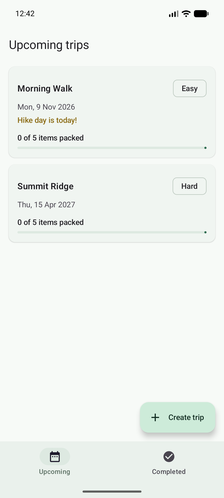
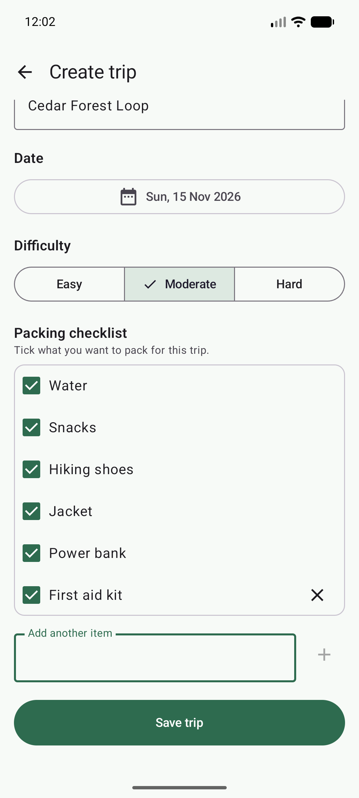
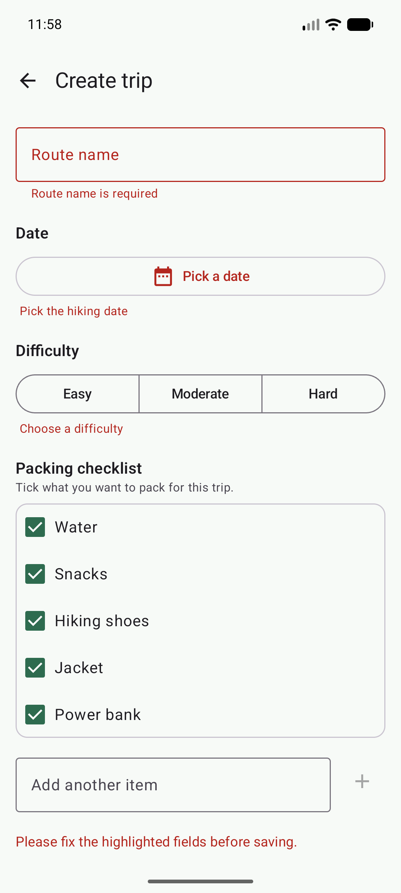
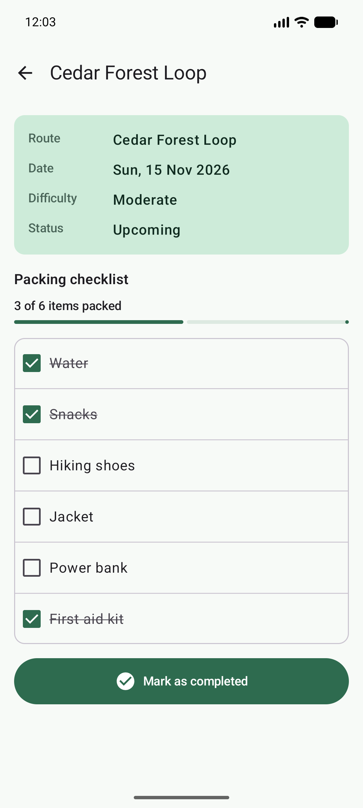
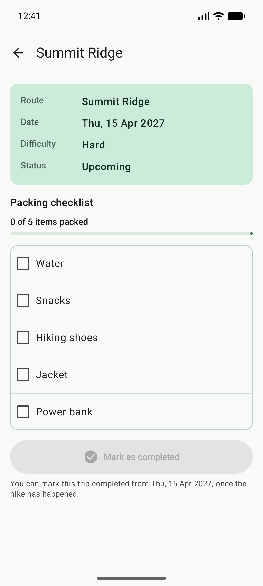

# Hiking Trip Planner

An Android app that helps hikers plan an outing, pack for it, and keep a record once it's done.
Built with **Kotlin** and **Jetpack Compose**. Works fully offline: everything is saved on the phone.

**Author:** Jean-Pierre Farah

> **Progress evaluation:** this repository contains the demonstrated feature,
> **"Plan a trip with its packing checklist"**. The full application is not finished yet
> (see [What's next](#whats-next)).

---

## The demonstrated feature

One complete flow, from creating a hike to archiving it:

1. **Create a trip**: route name, date (date picker), difficulty (Easy / Moderate / Hard) and a packing checklist
   (Water, Snacks, Hiking shoes, Jacket, Power bank; untick items or add your own).
2. **Validation before saving**: route name required (max 60 characters), date can't be in the past,
   difficulty required, at least one packing item.
3. **Upcoming trips list**: the saved trip appears with its packing progress ("3 of 5 items packed").
4. **Trip details**: route, date, difficulty, status and the checklist. Tick items as you pack;
   each tick is saved immediately.
5. **Saved on the device**: close and reopen the app and the trips and ticks are still there (Room database).
6. **Mark as completed** (on or after the hike date): the trip moves to the **Completed** tab as a read-only record.

| Upcoming trips | Create trip | Validation | Trip details | Future trip |
|---|---|---|---|---|
|  |  |  |  |  |

---

## How to run the app

### Requirements
- **Android Studio** 2026.1 or newer (it includes the Java JDK the build needs)
- **Android SDK Platform 37** (Android Studio offers to install it on first sync if missing)
- An **emulator** (e.g. Pixel 8, API 37) or an Android phone with **USB debugging** enabled.
  Minimum Android version: **8.0 (API 26)**

### Steps
1. Clone the repository:
   ```bash
   git clone https://github.com/Farah24-14/hiking_trip_planner-feature.git
   ```
2. In Android Studio choose **File → Open** and select the cloned folder. Click **Trust Project** if asked.
3. Wait for the **Gradle sync** to finish. The first sync downloads the dependencies, so an internet connection is needed.
4. Pick a device in the toolbar (create one under **Tools → Device Manager** if the list is empty).
5. Press **▶ Run 'app'**. The app opens on the **Upcoming trips** screen.

### From the command line (optional)
```bash
# Windows
gradlew.bat assembleDebug          # build the APK -> app/build/outputs/apk/debug/app-debug.apk
gradlew.bat installDebug           # install it on a running emulator / connected phone
gradlew.bat testDebugUnitTest      # run the unit tests

# macOS / Linux
./gradlew assembleDebug
```

### Demo script
1. Press **Save trip** on an empty form: an error appears under each required field.
2. Create **"Cedar Forest Loop"**, pick a date, choose *Moderate*, add **"First aid kit"**, save.
3. Open the trip and tick a few items; the progress bar updates.
4. Close the app completely and reopen it: the trip and the ticks are still there.
5. A trip dated today (or earlier) can be **marked as completed** and moves to the *Completed* tab.
   A future trip shows the button disabled with an explanation.

---

## How it's built

```
Compose screens  →  ViewModels (StateFlow)  →  TripRepository  →  TripDao (Room)  →  hiking.db
```

- **UI:** single Activity, Jetpack Compose, Material 3
- **Navigation:** Navigation-Compose (`upcoming`, `completed`, `create`, `trip/{tripId}`)
- **Architecture:** MVVM, one ViewModel per screen, UI state exposed as `StateFlow`
- **Storage:** Room (tables `trips` and `checklist_items`, linked by a foreign key with CASCADE delete).
  A trip and its checklist are inserted in one transaction, and Flow queries refresh the UI automatically.
- **Tests:** 14 JUnit tests for the form validation and the completion rules

### Project structure
```
app/src/main/java/com/usj/hikingplanner/
├── data/          Room entities, DAO, database, repository, trip rules
├── ui/
│   ├── triplist/  Upcoming & Completed screens
│   ├── create/    Create-trip form + validation
│   ├── detail/    Trip details, checklist, mark as completed
│   ├── navigation/ Routes and NavHost
│   ├── common/    Date formatting helpers
│   └── theme/     Colors
├── HikingApp.kt   Application (creates the repository)
└── MainActivity.kt
app/src/test/      Unit tests
```

### Tech stack
Kotlin 2.2 · Android Gradle Plugin 9.4 · Gradle 9.6 · Compose BOM 2026.02 · Material 3 ·
Navigation-Compose 2.9 · Room 2.8 (KSP) · compileSdk / targetSdk 37 · minSdk 26

---

## What's next
- Edit and delete trips
- Weather forecast for the hike date (Retrofit + weather API), with loading / error / retry states
- Hike-day reminders (WorkManager + notification)
- UI tests and polish
